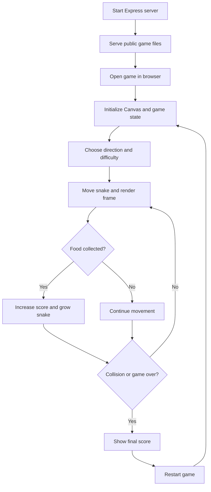

# SNAKE GAME

**A classic grid-based Snake game built with HTML Canvas and JavaScript.**

A small browser game exploring game loops, keyboard input, collision handling, and level progression.

---

## Overview

This repository contains an early Snake game implementation with a fixed-size Canvas playfield. The player guides the snake to collect food, increase the score, and progress through difficulty levels.

## Gameplay

- Grid-based movement rendered through the HTML Canvas 2D API.
- Food collection and score tracking.
- Easy, Medium, and Hard difficulty behavior.
- Wall wrapping on the easier levels and wall collision in Hard mode.
- Level-up transition panel.
- Pause, resume, and restart controls.
- Increasing game speed as the difficulty changes.

## Game flow

## Technology

- HTML5
- CSS3
- Vanilla JavaScript
- HTML Canvas 2D API
- Node.js and Express for local static serving

## Requirements

- Node.js and npm.
- A modern browser that supports Canvas 2D.

## Getting started

    git clone https://github.com/gusti111/snake-game.git
    cd snake-game
    npm install
    npm start

Open the local URL printed by the server. The server entry point is server.js.

## Repository structure

    snake-game/
    ├── public/
    │   ├── index.html
    │   ├── game.js
    │   └── style.css
    ├── server.js
    ├── package.json
    └── vercel.json

## Project status

An introductory browser-game project. The repository includes node_modules in its current Git history; dependency folders should normally be excluded from source control and restored using npm install.

No online multiplayer, account system, or cloud leaderboard is documented for this version.

## Author

**Gusty Faqikh** · [GitHub](https://github.com/gusti111)